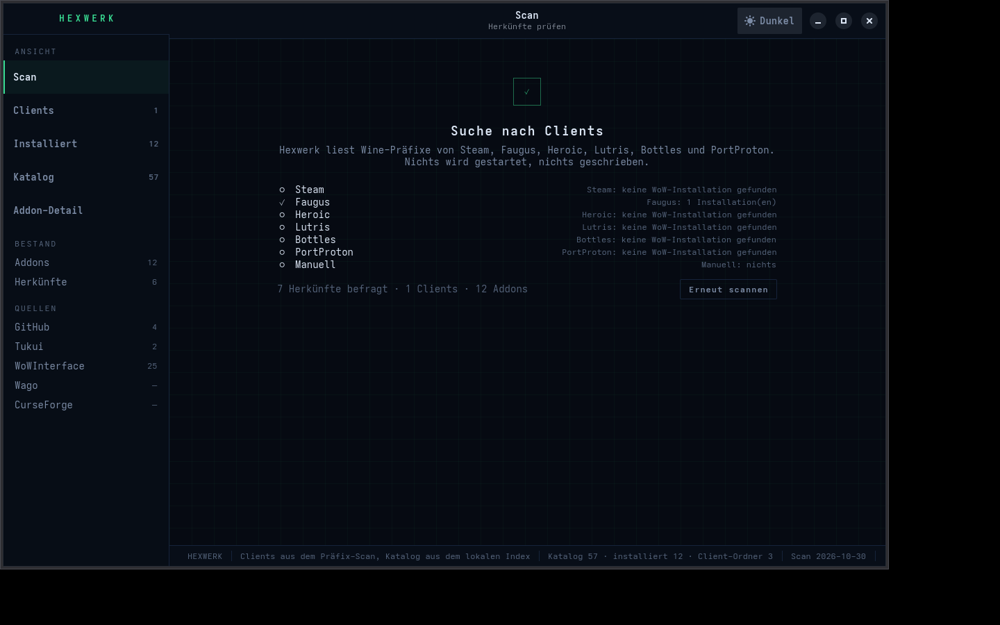

# Hexwerk

Addon-Manager für World of Warcraft unter Linux. Hexwerk findet jede
WoW-Installation in einem Wine-Präfix, egal ob sie über Steam und Proton,
Faugus, Heroic, Lutris, Bottles, PortProton oder von Hand angelegt wurde, und
verwaltet die Addons aller Client-Versionen aus einem Fenster.

Native Oberfläche mit GTK4 und libadwaita, Kern in Rust, lokaler Index für die
Suche. Keine Browserschnittstelle, kein Hintergrunddienst, kein Konto.

## Funktionen

* Erkennt Steam und Proton, Faugus und UMU, Heroic, Lutris, Bottles,
  PortProton und jeden Ordner, den du selbst auswählst.
* Alle Client-Versionen: Retail, Classic, Classic Era, Anniversary, Forever und
  die PTR-Varianten, jede mit eigener Addon-Liste.
* Katalog aus mehreren Quellen. Dasselbe Addon aus mehreren Märkten ist ein
  Eintrag mit den Versionen je Quelle.
* Suche über einen lokalen Index (SQLite mit FTS5), damit das Fenster auch ohne
  Netz und während eines Scans bedienbar bleibt.
* Addons werden erkannt, nicht eingetragen: über die Projektkennungen in der
  `.toc` und über einen Fingerprint des Ordners. Updates funktionieren damit
  auch für Addons, die von Hand installiert wurden.
* Installation entpackt mit Ordnerkorrektur, sichert vorher den alten Stand und
  verschiebt Gelöschtes in einen Papierkorb.
* Dunkle und helle Darstellung, Umschaltung im Fenster, Wahl wird gemerkt.

## Screenshots

| | |
|---|---|
|  |  |
| Scan beim Start | Gefundene Clients je Herkunft |
|  |  |
| Addons je Client-Ordner | Katalog aus dem lokalen Index |


## Installation

Ein Flatpak ist vorbereitet (`flatpak/de.weppelmann.Hexwerk.yml`, Runtime
`org.gnome.Platform//51`), aber noch nicht veröffentlicht.

Aus dem Quelltext, Kommandozeile:

```bash
cargo build --release
./target/release/hexwerk scan
```

Oberfläche: sie braucht die GTK4- und libadwaita-Entwicklungspakete. Fehlen sie
auf dem System, baut man sie in einem Container:

```bash
podman build -t hexwerk-buildenv -f packaging/Containerfile .
podman run --rm -v "$PWD":/work:z -w /work hexwerk-buildenv \
  sh -lc 'cd crates/ui-gtk && cargo build --release'
```

## Benutzung

Kommandozeile:

```bash
hexwerk scan                 # Präfixe und Clients suchen
hexwerk addons               # Clients und ihre Addons listen
hexwerk index                # lokalen Index aus dem Dateisystem bauen
hexwerk index --net bags     # Quellen befragen und Katalog füllen
hexwerk search weakauras     # im lokalen Index suchen
hexwerk keys list            # Quellen mit Schlüssel und ihre Herkunft
hexwerk keys set wago <token>
hexwerk keys test            # jede Quelle mit einer echten Anfrage prüfen
```

Im Fenster: links die Ansichten, in der Kopfleiste der Umschalter zwischen
System, Dunkel und Hell. Der Katalog liest ausschließlich den lokalen Index,
der beim Start im Hintergrund aus den Quellen ergänzt wird.

## Quellen und Schlüssel

Ohne Zugangsdaten nutzbar: **GitHub**, **Tukui**, **WoWInterface**.
Mit eigenem Schlüssel: **Wago** (Token) und **CurseForge** (API-Key). Beide sind
abgeschaltet, solange kein Schlüssel hinterlegt ist.

Hexwerk liefert bewusst keinen fremden Schlüssel mit: CurseForge vergibt Keys an
den einzelnen Entwickler und nicht übertragbar. Ein eigener Key wird gesetzt
über `hexwerk keys set curseforge <key>`, über `~/.config/hexwerk/keys.json`
(Modus 0600) oder über `HEXWERK_CURSEFORGE_KEY`. Ausgegeben wird ein Schlüssel
nie vollständig, nur die letzten vier Zeichen.

Die gemessenen Endpunkte und Antwortformen stehen in
[`docs/QUELLEN.md`](docs/QUELLEN.md).

## Aufbau

| Paket | Aufgabe |
|---|---|
| `crates/core` | Präfixe finden, `.toc` lesen, installierte Addons erfassen |
| `crates/sources` | Quellen: GitHub, Tukui, WoWInterface, Wago, CurseForge, Fingerprint |
| `crates/index` | lokaler Index (SQLite, FTS5) für Suche, Katalog und Bestand |
| `crates/install` | Installation, Sicherung, Papierkorb |
| `crates/ui-gtk` | Oberfläche (GTK4, libadwaita) |
| `src/` | Kommandozeile |

Datenfluss und Datenmodell als Diagramm in
[`docs/ARCHITEKTUR.md`](docs/ARCHITEKTUR.md). Arbeitspakete und Risiken in
[`PLAN.md`](PLAN.md). Entwicklungsumgebung und Prüfwerkzeuge in
[`docs/ENTWICKLUNG.md`](docs/ENTWICKLUNG.md).

## Stand

Version 0.1.0, kein Release. Kern und Oberfläche laufen, der Katalog zieht echte
Daten aus den Quellen.

| Teil | Stand |
|---|---|
| Präfix-Erkennung | fertig, 48 Tests |
| Quellen | fertig, 50 Tests, echter Netztest über `crates/sources/examples/probe.rs` |
| Index | fertig, 37 Tests |
| Installation | fertig, 30 Tests |
| Oberfläche | fünf Bildschirme, Dunkel und Hell, Katalog und Detail aus dem Index |
| Flatpak | Manifest und CI vorhanden, Bau lokal mit Attrappen-Binaries geprüft |

Offen: Veröffentlichung als Flatpak, Addon-Profile (schaltbare Sammlungen),
Bilder in der Detailansicht aus den Quellen, Nachladen beim Scrollen im Katalog.

## Lizenz

GPL-3.0-or-later, siehe [LICENSE](LICENSE).
