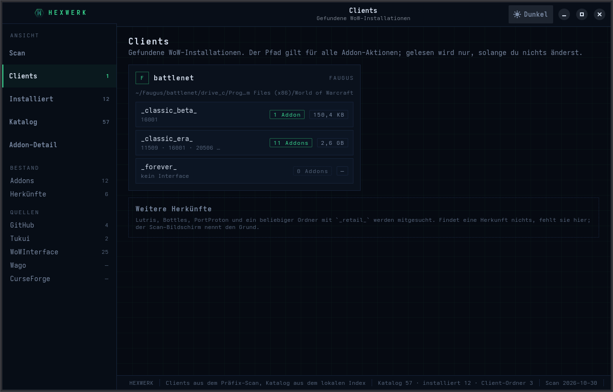
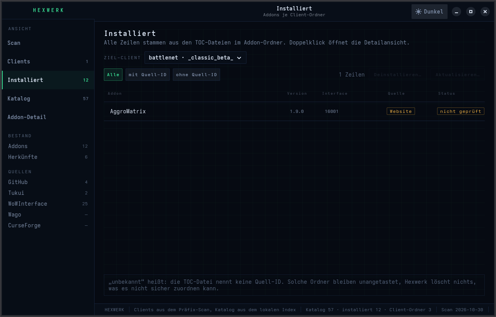
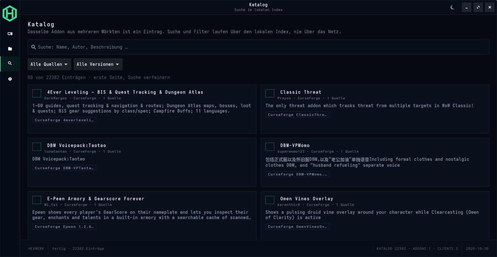
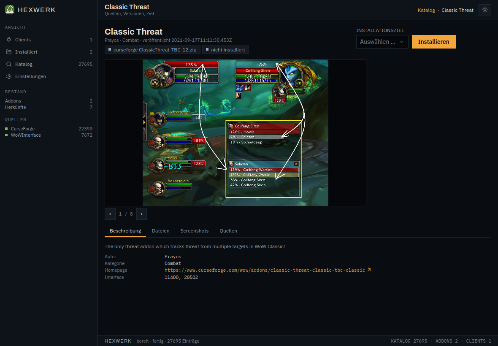
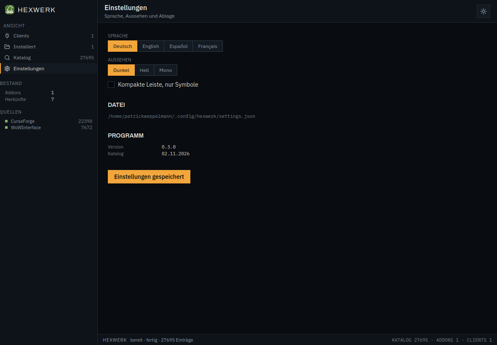

# Hexwerk

Addon-Manager für World of Warcraft unter Linux. Hexwerk findet jede
WoW-Installation in einem Wine-Präfix, egal ob sie über Steam und Proton,
Faugus, Heroic, Lutris, Bottles, PortProton oder von Hand angelegt wurde, und
verwaltet die Addons aller Client-Versionen aus einem Fenster.

Oberfläche mit Tauri 2 und Vue 3, Kern in Rust, lokaler Index für die Suche.
Kein Hintergrunddienst, kein Konto.

## Funktionen

* Erkennt Steam und Proton, Faugus und UMU, Heroic, Lutris, Bottles,
  PortProton und jeden Ordner, den du selbst auswählst.
* Alle Client-Versionen: Retail, Classic, Classic Era, Anniversary, Forever und
  die PTR-Varianten, jede mit eigener Addon-Liste.
* Katalog aus mehreren Quellen, ohne Zugangsdaten über 27.000 Einträge, dazu
  CurseForge und Wago, sobald ein eigener Schlüssel hinterlegt ist. Dasselbe
  Addon aus mehreren Märkten ist ein Eintrag mit den Versionen je Quelle.
* Suche über einen lokalen Index (SQLite mit FTS5), damit das Fenster auch ohne
  Netz und während eines Scans bedienbar bleibt.
* Addons werden erkannt, nicht eingetragen: über die Projektkennungen in der
  `.toc` und über einen Fingerprint des Ordners. Updates funktionieren damit
  auch für Addons, die von Hand installiert wurden.
* Detailseite mit Bildergalerie, Beschreibung, Dateien, Screenshots und Quellen;
  der Installationsstand gilt für den gewählten Spielordner.
* Installation entpackt mit Ordnerkorrektur, sichert vorher den alten Stand und
  verschiebt Gelöschtes in den Papierkorb des Desktops und holt es auf Wunsch
  zurück.
* Vier Sprachen (deutsch, englisch, spanisch, französisch) und drei Farbschemata
  (dunkel, hell, mono); die Wahl wird gemerkt.

## Plattformen

Die Erkennung ist plattformneutral gebaut: Herkünfte sind Daten (Wurzeln), keine
`cfg`-Abfragen im Code. Gesucht wird überall gleich — ein Ordner heißt
`World of Warcraft` und enthält `_retail_`-artige Verzeichnisse.

| System | Herkünfte |
|---|---|
| Linux | Steam/Proton, Faugus/UMU, Heroic, Lutris, Bottles, PortProton, eigener Ordner |
| Windows | `%ProgramFiles%` und `%ProgramFiles(x86)%` |
| macOS | CrossOver-Flaschen und Whisky, dazu `/Applications` (Blizzard-Launcher) |

Auf macOS sind CrossOver-Flaschen Wine-Präfixe und laufen durch dieselbe Prüfung
wie Bottles unter Linux; unter Windows verhält sich `Program Files` wie ein
`drive_c`. Beides ist gegen künstliche Bäume getestet
(`crates/core/tests/plattform_herkuenfte.rs`).

Für alle drei Systeme gibt es Pakete: Linux als Tarball und Flatpak, macOS als
Universal-DMG (arm64 und x86_64, ad-hoc signiert; mit Zertifikat in den Secrets
wird echt signiert und notarisiert), Windows als Portable-ZIP und
Inno-Setup-Installer. Die Jobs laufen in der CI auf `ubuntu-24.04`,
`macos-latest` und `windows-latest`.

Der Papierkorb nutzt bisher den XDG-Papierkorb des Linux-Desktops; unter Windows
und macOS landet Gelöschtes in einem eigenen Ordner.

## Screenshots

| | |
|---|---|
|  |  |
| Gefundene Clients je Herkunft, Spielordner als Tabelle | Addons je Spielordner, Deinstallieren in den Papierkorb |
|  |  |
| Katalog mit Kästchen-Filtern je Quelle und Interface | Detailseite mit Galerie, Reitern und Installationsziel |
|  | |
| Sprache, Aussehen, Ablage | |

Der Katalog kommt fertig vom Dienst (`hexwerk-api.weppelmann.eu`): die App hält
keinen CurseForge-Schlüssel und lädt nur den gepackten Snapshot. Bilder werden
erst geholt, wenn ein Eintrag geöffnet wird.

## Installation

Aus dem Quelltext:

```bash
cargo build --release                       # Kommandozeile
npm --prefix ui ci && npm --prefix ui run build
cd crates/desktop && cargo build --release --features custom-protocol
```

Das Fenster braucht WebKitGTK und GTK 3 zur Bauzeit:

```bash
sudo dnf install webkit2gtk4.1-devel gtk3-devel libappindicator-gtk3-devel librsvg2-devel
```

Ein Flatpak ist vorbereitet (`flatpak/de.weppelmann.Hexwerk.yml`), mit der
Tauri-Fassung aber noch nicht gebaut: das Manifest muss das Frontend mitbauen
und WebKit aus der Runtime nehmen. Bauanleitung:
[`flatpak/README.md`](flatpak/README.md).

## Benutzung

Kommandozeile:

```bash
hexwerk scan                 # Präfixe und Clients suchen
hexwerk addons               # Clients und ihre Addons listen
hexwerk index                # lokalen Index aus dem Dateisystem bauen
hexwerk index --net bags     # Quellen befragen und Katalog füllen
hexwerk search weakauras     # im lokalen Index suchen
hexwerk keys list            # Quellen mit Schlüssel und ihre Herkunft
hexwerk keys set curseforge <key>
hexwerk keys test            # jede Quelle mit einer echten Anfrage prüfen
```

Im Fenster: links die Ansichten, in der Kopfleiste der Umschalter zwischen den
Farbschemata. Der Katalog liest ausschließlich den lokalen Index, der beim Start
im Hintergrund aus den Quellen ergänzt wird.

## Quellen und Schlüssel

Ohne Zugangsdaten nutzbar: **WoWInterface** (über den Dienst). Mit eigenem
Schlüssel: **CurseForge** (API-Key) und **Wago** (Token). Beide sind
abgeschaltet, solange kein Schlüssel hinterlegt ist.

Hexwerk liefert bewusst keinen fremden Schlüssel mit: CurseForge vergibt Keys an
den einzelnen Entwickler und nicht übertragbar. Ein eigener Key wird gesetzt
über `hexwerk keys set curseforge <key>`, über `~/.config/hexwerk/keys.json`
(Modus 0600) oder über `HEXWERK_CURSEFORGE_KEY`. Ausgegeben wird ein Schlüssel
nie vollständig, nur die letzten vier Zeichen.

## Aufbau

| Paket | Aufgabe |
|---|---|
| `crates/core` | Präfixe finden, `.toc` lesen, installierte Addons erfassen |
| `crates/sources` | Quellen: GitHub, Tukui, WoWInterface, Wago, CurseForge, Fingerprint |
| `crates/index` | lokaler Index (SQLite, FTS5) für Suche, Katalog und Bestand |
| `crates/install` | Installation, Sicherung, Papierkorb |
| `crates/desktop` | Fenster (Tauri 2): Befehle, keine Fachlogik |
| `ui/` | Oberfläche (Vue 3), baut gegen `weppelmann-ui` |
| `src/` | Kommandozeile |

Die Oberfläche teilt ihre Bausteine mit wledambilight und crosspoint
([`weppelmann-ui`](https://github.com/Smotherer007/weppelmann-ui)), eingebunden
als Untermodul.

Datenfluss und Datenmodell als Diagramm in
[`docs/ARCHITEKTUR.md`](docs/ARCHITEKTUR.md). Arbeitspakete und Risiken in
[`PLAN.md`](PLAN.md).

## Stand

Version 0.4.0.

| Teil | Stand |
|---|---|
| Präfix-Erkennung | fertig |
| Quellen | fertig, echter Netztest über `crates/sources/examples/probe.rs` |
| Index | fertig, Katalog 27.695 Einträge |
| Installation | fertig, 36 Tests |
| Fenster | fünf Ansichten, vier Sprachen, drei Farbschemata |
| Tests | 93 in Rust |
| Flatpak | baut im Sandkasten |
| Windows/macOS | Pakete im Release, CI baut beide |

Offen:

* Veröffentlichung als Flatpak.
* Notizen zu einem Addon (die GTK-Fassung hatte sie).
* Kontextmenü auf einem Addon (installieren, deinstallieren, Ordner öffnen).
* Addon-Profile (schaltbare Sammlungen).

## Lizenz

GPL-3.0-or-later, siehe [LICENSE](LICENSE).
