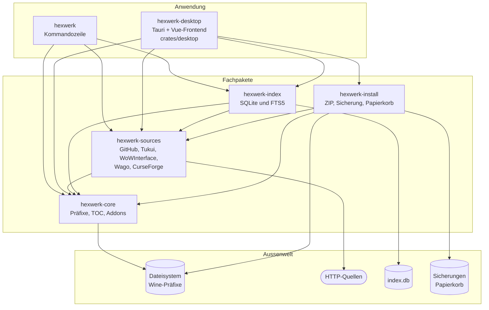
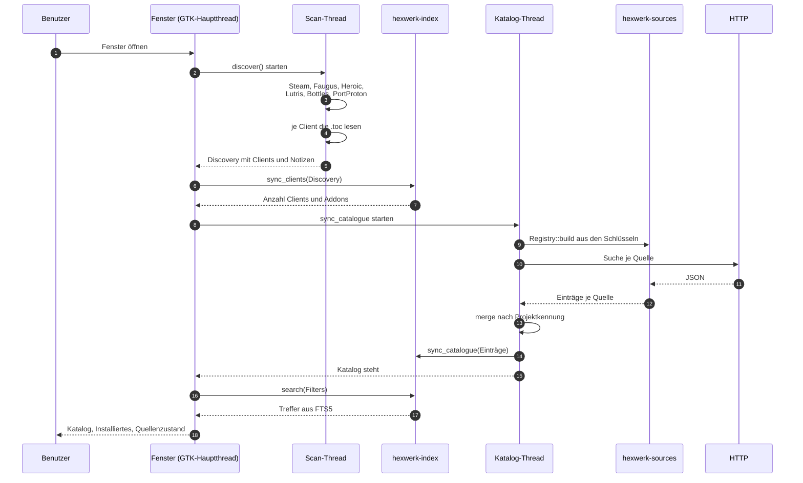
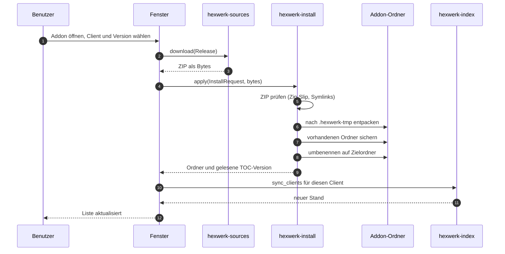
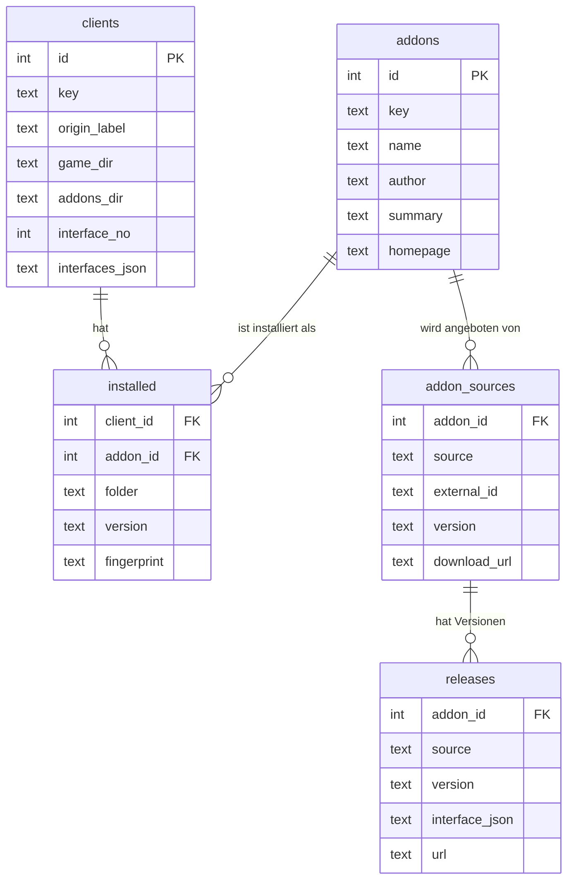
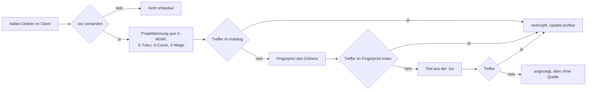
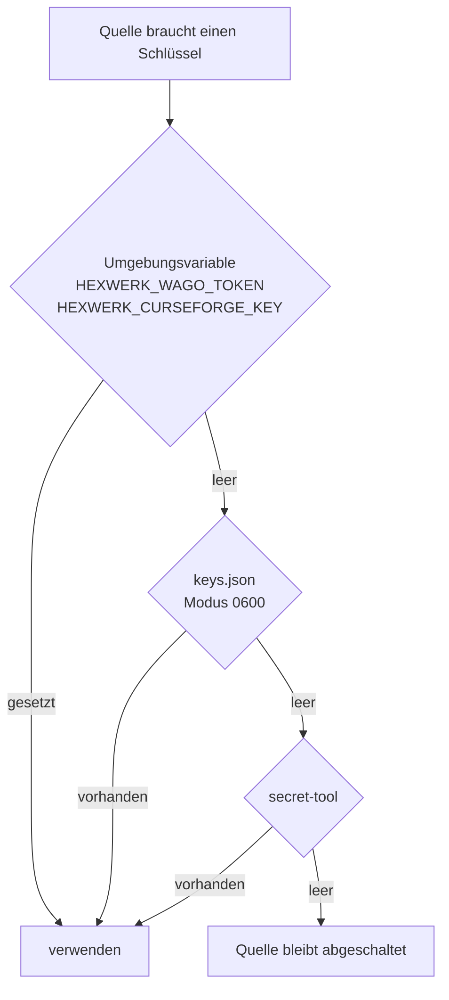

# Architektur

Stand 2026-10-30. Diese Datei beschreibt den Aufbau des Programms und den Weg
der Daten. Sie ist die verbindliche Übersicht; die Details stehen in
`PLAN.md` und in den Modulköpfen des Quelltexts.

## Zuschnitt

Hexwerk ist ein Cargo-Workspace mit einem Kern und drei Fachpaketen. Die
Oberfläche ist ein eigenes Paket mit eigener `[workspace]`-Tabelle, damit sie
sich unabhängig bauen lässt und GTK nur dann im Abhängigkeitsbaum landet, wenn
jemand sie anfasst.

Regel für die Richtung: `core` kennt niemanden, `sources`, `index` und
`install` kennen `core`, die Oberfläche kennt alle. Kein Paket ruft ein
späteres auf, damit kein Zyklus entsteht.

## Datenfluss beim Start

Der Scan liest das Dateisystem und dauert auf einem gefüllten Addon-Ordner
Sekunden. Er läuft deshalb nicht im GTK-Hauptthread.

Zwei Zusagen daraus:

1. Das Fenster fasst im Hauptthread keine Festplatte und kein Netz an.
2. Der Katalog wird nur ergänzt, nie geleert. Fällt eine Quelle aus, bleibt der
   vorherige Stand sichtbar und der Fehler steht daneben.

## Datenfluss einer Installation

Ein Abbruch zu jedem Zeitpunkt lässt den alten Stand stehen: entpackt wird in
einen temporären Ordner, gesichert wird vor dem Umbenennen.

## Datenmodell des Index

`addons` trägt einen FTS5-Index über Name, Autor und Kurztext. Die Suche läuft
über `bm25`, nicht über `LIKE`, damit sie auch bei einigen tausend Einträgen
sofort antwortet. Der Index ist eine Datei unter
`~/.local/share/hexwerk/index.db`, im WAL-Modus, damit Lesen und Schreiben
gleichzeitig gehen.

## Erkennung eines installierten Addons

Ein Addon wird nicht eingetragen, sondern erkannt. Die Reihenfolge der Beweise:

Was ohne Quelle bleibt, wird angezeigt und nie angefasst. Löschen setzt eine
sichere Zuordnung voraus.

## Schlüssel

Ausgegeben wird ein Schlüssel nie vollständig, nur die letzten vier Zeichen.
Ein mitgelieferter CurseForge-Schlüssel ist nicht zulässig, weil Schlüssel bei
CurseForge an den einzelnen Entwickler gebunden sind; Hexwerk liefert deshalb
keinen fremden Schlüssel aus.

## Verzeichnisse zur Laufzeit

| Zweck | Pfad |
|---|---|
| Index | `~/.local/share/hexwerk/index.db` |
| Sicherungen | `~/.local/share/hexwerk/backup` |
| Papierkorb | `~/.local/share/Trash` (der des Desktops) |
| Schlüssel | `~/.config/hexwerk/keys.json` |
| Fensterzustand | `~/.config/hexwerk/ui.json` |
| HTTP-Zwischenspeicher | `~/.cache/hexwerk` |

## Entscheidungen und ihre Gründe

| Entscheidung | Grund |
|---|---|
| GTK4 mit libadwaita statt eigenem Widgetsatz | `AdwSpinner`, `AdwToast` und `AdwStyleManager` bringen Animation, Rückmeldung und Dunkel/Hell mit; dieselbe GTK-Version wie im Nachbarprojekt |
| SQLite mit FTS5 statt eigenem Suchindex | Ein Dateiformat, Transaktionen, Suche mit Rangfolge; keine zusätzliche Abhängigkeit im Betrieb |
| Eigene Fingerprint-Definition | WowUps Verfahren ist nicht offengelegt; die eigene Definition ist dokumentiert und reproduzierbar |
| Kein Netz im GTK-Hauptthread | Sonst friert das Fenster bei langsamen Quellen ein |
| Cargo-Quellen im Flatpak eingefroren | Ohne `new-sources.json` prüft der Sandbox-Bau keine Prüfsummen; dann bricht er ab statt still durchzulaufen |

## Grenzen

* Wago und CurseForge sind vorbereitet, aber ohne eigenen Schlüssel nicht
  erreichbar; ihre Antwortformen sind deshalb nur aus der Dokumentation
  bekannt, nicht gemessen.
* Ein Präfix, der auf einem anderen Datenträger per Symlink liegt, wird nicht
  gefunden; der Scanner folgt keinen Symlinks unter `drive_c`.
* Der Fingerprint-Index von WowUp wird nur als Beschleuniger benutzt. Fällt er
  weg, bleibt die Erkennung über die Projektkennungen der `.toc` bestehen.
